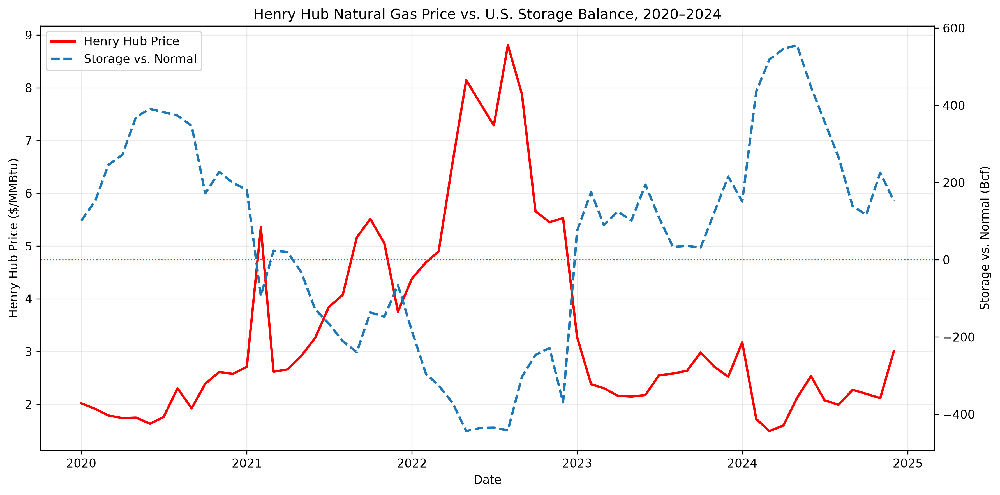

# U.S. Natural Gas & LNG Market Analysis

## Project Overview

This project analyzes how certain market variables affect Henry Hub natural gas prices.

Using historical data from the U.S. Energy Information Administration (EIA), the analysis examines the relationships between:

- Henry Hub Natural Gas Prices
- U.S. Dry Natural Gas Production
- U.S. Natural Gas Storage
- U.S. LNG Exports

The goal is to determine what supply/demand variables affect natural gas prices the most.

## Tools Used

- Python
- pandas
- NumPy
- Matplotlib
- SQL
- DuckDB
- JupyterLab

## Key Finding

Henry Hub prices were strongly correlated with storage levels, and weakly correlated with production or LNG exports individually.

Correlations are defined as follows (ranging from -1 to +1):

- +1 = perfect positive relationship
-  0 = no linear relationship
- −1 = perfect negative relationship

During 2020–2024, the "storage balance" (defined as storage levels relative to normal storage levels for a given month) had an approximately **-0.88 correlation** with Henry Hub prices. Monthly changes in the "storage balance" also had an approximately **-0.67 correlation** with monthly changes in Henry Hub prices.

These results suggest that the "storage balance" can serve as a useful indicator of the equilibrium between U.S. natural gas supply and demand.

## Key Visualization

## Data Sources

All datasets were obtained from the U.S. Energy Information Administration (EIA).

- Henry Hub Natural Gas Prices
- U.S. Dry Natural Gas Production
- U.S. Natural Gas Storage
- U.S. LNG Exports

## Methodology

### 1. Data Preparation

Python and pandas were used to import, clean, and standardize EIA datasets.

This included:

- Manipulating dates into consistent formats
- Converting production and LNG export volumes to Bcf/d
- Transforming observations to monthly frequencies
- Calculating natural gas storage relative to a historical seasonal benchmark ("storage balance")

### 2. SQL Analysis

SQL and DuckDB were used to query and combine individual datasets into one larger natural gas market dataset.

This included:

- Joining datasets by month and year
- Calculating LNG exports as a percentage of U.S. production
- Analyzing relationships between production, LNG exports, storage, and prices
- Comparing relationships across different LNG export periods

### 3. Statistical Analysis and Visualization

Python, pandas, NumPy, and Matplotlib were used to calculate correlations, examine monthly changes, and visualize relationships.

Particular attention was given to the data from 2020–2024 since U.S. LNG exports have become a more prominent part of the market in recent years, especially post-2016.

## Detailed Findings

### Storage and Henry Hub Prices

From 2020–2024, Henry Hub prices exhibited a strong negative correlation (**-0.88**) with the "storage balance".

The correlation between monthly changes in the "storage balance" and monthly changes in prices was also strongly negative (**-0.67**).

These findings suggest that storage conditions are a useful indicator of how oversupplied or undersupplied the market is, which provides a way to understand potential natural gas price fluctuations.

### Production and LNG Exports

During 2020–2024, production and LNG exports individually exhibited weak correlations with Henry Hub prices:

- Production vs. price: **0.02**
- LNG exports vs. price: **0.09**

However, production vs. LNG exports were strongly positively correlated (**0.80**), reflecting the growth of both during this period. It either suggests that rising U.S. production has helped accommodate the recent growth in LNG export demand, or it suggests that LNG export demand pushed the U.S. to increase its production capacity.

### Limitations

Several important natural gas market drivers were not directly modeled, including:

- Weather-driven events
- Heating and cooling demand
- Power generation demand
- Pipeline exports and imports
- International natural gas prices
- Infrastructure constraints
- Supply disruptions

The monthly data used may not accurately explain future short-term price volatility.

The "storage balance" should be interpreted as an accumulation of many supply/demand variables rather than an independent driver of prices.

## Conclusion

The results suggest that Henry Hub prices appear to be driven less by any single supply or demand variable and more by the balance between supply and demand (i.e. storage levels relative to normal storage levels aka "storage balance").

Among the variables analyzed, the "storage balance" exhibited the strongest relationship with Henry Hub prices during 2020–2024.

This project demonstrates the application of Python, SQL, statistical analysis, and data visualization to understanding fundamental energy market relationships.